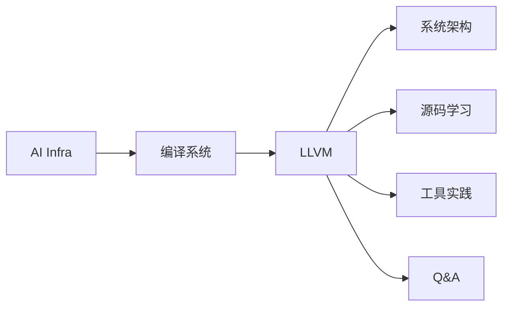

# AI Infra：从编译系统理解 AI 基础设施

AI Infra 是支持模型训练、推理和部署的基础设施。编译系统负责把计算表达转换成硬件可以执行的代码，是其中一个子领域。这里将不同子领域组织成独立课程，当前已提供 LLVM 学习路线。

## 课程分类

| 子领域 | 当前课程 | 学习内容 |
| --- | --- | --- |
| 编译系统 | [LLVM 学习入口](./llvm/) | Clang、IR、Pass、指令选择、寄存器分配、MC |
| 工具实践 | [LLVM 工具课](./llvm/tools/clang-gcc) | Clang、GCC、GDB、objdump、readelf、lit |
| 问题驱动学习 | [LLVM Q&A](./llvm/qa/) | 从具体问题追踪源码与阶段边界 |

## 从一条编译链开始

初次学习可以从 [LLVM 六周路线](./llvm/guide/learning-path) 开始；带着具体问题阅读，可以直接进入 [builtin 如何变成机器指令](./llvm/qa/builtin-to-instruction)。

## 与其他系统课程连接

编译器帮助理解代码如何执行，推理框架负责请求调度和模型运行，分布式系统负责计算和通信的组织。相关课程：[vLLM](../vllm/)、[SGLang](../sglang/)、[分布式训练](../distributed/)。
