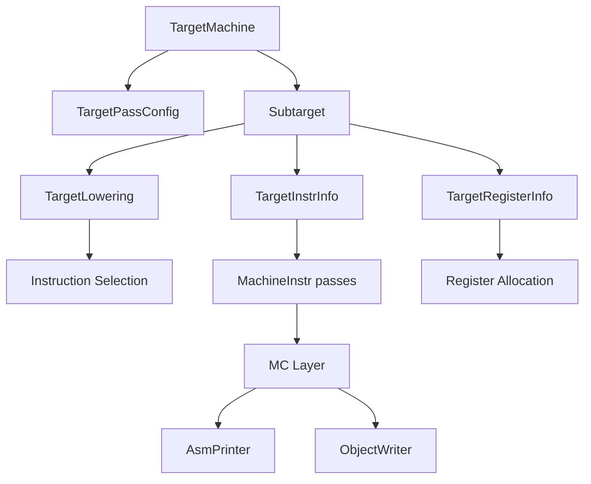

# LLVM Target 后端的组成

## 一张组件图



## 核心职责

| 组件 | 回答的问题 |
| --- | --- |
| `TargetMachine` | 当前 triple/cpu/features 对应哪个目标实例？ |
| `Subtarget` | 这个 CPU 具体支持哪些 feature、调度模型？ |
| `TargetLowering` | 哪些类型和 DAG 操作合法？非法操作如何降低？ |
| `TargetInstrInfo` | 目标指令如何复制、分支、spill、调度？ |
| `TargetRegisterInfo` | 有哪些物理寄存器、类、subreg、保留寄存器？ |
| `TargetFrameLowering` | stack frame、prologue/epilogue 如何建立？ |
| `AsmPrinter` / MC | MachineInstr 如何变成 MCInst、文本和字节？ |

## TableGen 描述什么

TableGen 常描述大量规则化数据：

- register 与 register class；
- instruction operand、encoding、asm string；
- DAG pattern；
- calling convention；
- subtarget feature 与 scheduling model。

它在构建 LLVM 时生成 `.inc`，目标 C++ 通过宏片段包含这些结果。TableGen 不是用户程序编译时解释 `.td` 的脚本。

## 公开后端的阅读入口

建议先比较 AArch64 与 RISC-V：

```text
llvm/lib/Target/AArch64/
llvm/lib/Target/RISCV/
```

第一遍只追简单整数加法、一次 load/store、一次函数返回。向量、原子、TLS、GlobalISel 与复杂 pseudo 放到第二轮。

