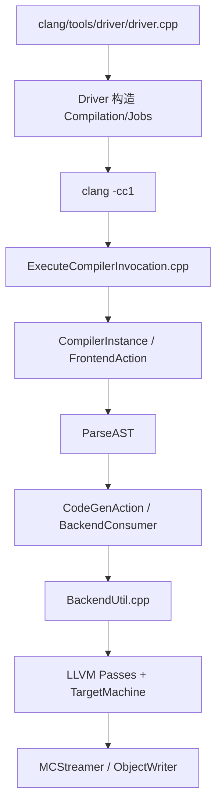

# LLVM 源码地图与阅读方法

## 仓库不是一个程序

| 目录 | 角色 | 初学者第一入口 |
| --- | --- | --- |
| `clang/` | C/C++ 前端与 driver | `clang/tools/driver/driver.cpp` |
| `llvm/` | IR、优化器、CodeGen、MC、工具 | `llvm/tools/opt`、`llvm/tools/llc` |
| `lld/` | ELF/COFF/Mach-O/Wasm 链接器 | `lld/tools/lld/lld.cpp` |
| `compiler-rt/` | sanitizer、builtins 等运行库 | 按具体符号进入 |
| `libcxx/` | C++ 标准库 | 不属于 Clang 前端本体 |
| `mlir/` | 多层 IR 基础设施 | 先学 LLVM IR 后再进入 |

## 一次 `clang test.c` 的源码主线



不要第一遍追所有虚函数。每到一层只记录：

1. 输入对象是什么；
2. 谁拥有它；
3. 哪个函数改变了它；
4. 能用什么选项打印它。

## 后端目录阅读模板

以公开目标 `llvm/lib/Target/RISCV/` 为例：

| 文件类型 | 解决的问题 |
| --- | --- |
| `RISCVTargetMachine.cpp` | 目标机与 pass pipeline 如何组装 |
| `RISCVISelLowering.cpp` | LLVM DAG 操作如何合法化/降低 |
| `RISCVISelDAGToDAG.cpp` | 特殊 DAG 节点如何手写选择 |
| `RISCVInstrInfo.td` | 寄存器操作数、指令与 pattern |
| `RISCVRegisterInfo.td` | 物理寄存器、subreg、寄存器类 |
| `RISCVInstrInfo.cpp` | MachineInstr 层目标 hook |
| `MCTargetDesc/` | 指令编码、汇编后端与 object emission |
| `AsmParser/` | 汇编文本如何解析成 MCInst |
| `Disassembler/` | 指令字节如何解码成 MCInst |

## 用 `rg` 建立证据链

```bash
# 先找精确符号，不要浏览整个目录
rg -n 'EmitBuiltinExpr\(' clang/lib/CodeGen
rg -n 'void RISCVDAGToDAGISel::Select' llvm/lib/Target/RISCV
rg -n 'Cannot select:' llvm/lib/CodeGen

# 找 TableGen 定义与 C++ 使用者
rg -n '\bADDI\b' llvm/lib/Target/RISCV
rg -n 'GET_INSTRINFO' llvm/lib/Target/RISCV llvm/utils/TableGen
```

## 阅读记录模板

| 项目 | 内容 |
| --- | --- |
| 当前阶段 | 例如 Clang CodeGen |
| 当前对象 | `CallExpr` / `llvm::CallInst` / `SDNode` / `MachineInstr` |
| 创建者 | 函数与文件 |
| 关键状态 | opcode、type、operand、register class |
| 消费者 | 下一阶段函数 |
| 可观测命令 | AST/IR/MIR dump 命令 |

