# 从这里开始：把 LLVM 看成一条可观测的翻译流水线

如果把 LLVM 理解成“一个编译器”，很快会被 Clang、IR、Pass、SelectionDAG、MIR、TableGen、MC 和 LLD 淹没。更准确的起点是：**LLVM 是一套分层编译基础设施；每一层都有明确的输入、输出、数据结构和可观测工具。**

本站绑定开源 llvm-project 提交 [`2078da4`](https://github.com/llvm/llvm-project/tree/2078da43e25a4623cab2d0d60decddf709aaea28)。讲解以 Clang + LLVM 中后端 + AArch64/RISC-V 公开后端为例，不包含任何私有目标实现。

## 先回答四个问题

| 问题 | 真正考察什么 | 答不上从哪里开始 |
| --- | --- | --- |
| `clang test.c` 为什么同时完成前端、优化、汇编和链接？ | driver 与各阶段边界 | [编译器完整流水线](./architecture/compiler-pipeline) |
| LLVM IR 和 MIR 有什么区别？ | 与目标无关/相关的中间表示 | [IR、SelectionDAG 与 MIR](./architecture/ir-dag-mir) |
| `.td` 为什么能“生成 C++”？ | TableGen 是构建期代码生成器 | [指令选择与 TableGen](./source/instruction-selection) |
| 崩溃在 `copyPhysReg()`，根因一定在那里吗？ | 最早异常状态与最后检测点 | [寄存器分配与 spill](./source/register-allocation) |

## 一份源码的全局旅程

```mermaid
flowchart LR
    C[C/C++ source] --> D[Clang Driver]
    D --> PP[Preprocessor]
    PP --> AST[Parser + Sema<br/>AST]
    AST --> CG[Clang CodeGen]
    CG --> IR[LLVM IR]
    IR --> OPT[IR Passes]
    OPT --> DAG[SelectionDAG / GlobalISel]
    DAG --> MIR[Machine IR]
    MIR --> RA[Register Allocation]
    RA --> MC[MC Layer]
    MC --> OBJ[Object File]
    OBJ --> LLD[Linker]
    LLD --> EXE[Executable]
```

这条链有三个重要分界：

- **语言分界**：AST 仍理解 C/C++ 类型、重载和模板；LLVM IR 不再保留完整语言语义。
- **目标分界**：IR 大体与目标无关；SelectionDAG/MIR 开始携带目标寄存器类和 opcode。
- **文件分界**：MC 把机器指令编码成 section、symbol 和 relocation；链接器再组合多个目标文件。

## 五个通关站点

| 站点 | 学习任务 | 必须留下的证据 |
| --- | --- | --- |
| 00 地图 | 分清 Clang、LLVM、LLD、libc | 能画出从源码到 ELF 的阶段图 |
| 01 表示 | 读懂 AST、IR、DAG、MIR | 同一函数的四种表示 |
| 02 源码 | 沿一次编译追关键入口 | 文件、函数、核心对象和阶段输出 |
| 03 工具 | 用命令切开每个阶段 | 可复制命令与真实产物 |
| 04 调试 | 从最早异常状态定位 | 最后正常/第一个异常 pass |

## 推荐学习顺序

1. 先按[六周学习路线](./guide/learning-path)建立节奏。
2. 用[编译器完整流水线](./architecture/compiler-pipeline)固定全局地图。
3. 在[源码地图](./guide/source-map)中只追一条主线，不遍历整个仓库。
4. 按[工具实验](./tools/clang-gcc)逐阶段留下 `.i`、`.ll`、`.s`、`.o` 和可执行文件。
5. 遇到具体问题，到 [Q&A](./qa/) 按错误阶段查答案。

::: tip 学习原则
先确认“当前对象是什么、处在哪个阶段、由谁创建、下一个消费者是谁”，再深入算法。知道一百个类名，不如能证明第一个错误状态在哪个 pass 出现。
:::

## 通关检查

学完整站后，你应能独立完成：

- 用 `clang -ccc-print-phases` 解释一次编译包含哪些 job；
- 用 `-E`、`-emit-llvm`、`-S`、`-c` 固定阶段边界；
- 区分 AST、LLVM IR、SelectionDAG、MIR 与 MC；
- 从 builtin 追到 intrinsic，再追到公开目标指令；
- 使用 GDB 验证当前运行的编译器和实际调用栈；
- 使用 `llvm-objdump`、`readelf`、`nm` 验证 section、symbol、relocation 和指令编码；
- 面对 `Cannot select`、MachineVerifier、链接错误时先定位阶段，而不是先猜修复。

