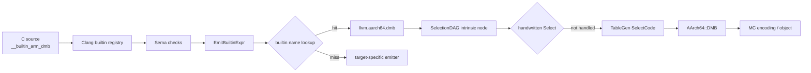
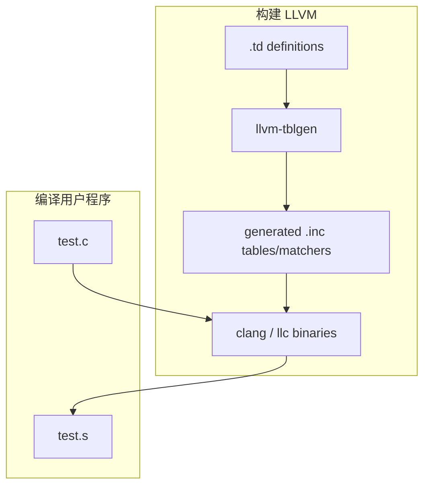

# builtin 如何一步步变成机器指令？

> 本文是原 builtin 交互课程的站内版本。内容只使用公开 llvm-project 源码，并以 AArch64 `__builtin_arm_dmb(1)` 为贯穿例子。

## 先区分三个概念

| 名称 | 所属层 | 本例 |
| --- | --- | --- |
| builtin | Clang 认识的特殊 C/C++ 接口 | `__builtin_arm_dmb(1)` |
| intrinsic | LLVM IR 中有特殊语义的操作 | `llvm.aarch64.dmb(i32 1)` |
| machine instruction | 目标 ISA 可编码的指令 | `DMB` |

builtin 看起来像函数，但不一定产生普通外部函数 call；intrinsic 以 `llvm.` 开头，由优化器和后端理解；机器指令属于具体 ISA。三者不保证一一对应。

## 完整路线



## 第一步：Clang 登记 builtin

文件：`clang/include/clang/Basic/BuiltinsAArch64.def:87`

```c
BUILTIN(__builtin_arm_dmb, "vUi", "nc")
```

它登记名称、C 函数类型和属性。`vUi` 表示 void 返回值和一个 unsigned int 参数。Clang 解析调用时可以绑定 BuiltinID，并由 Sema 检查立即数范围等约束。

## 第二步：intrinsic 记录声明自动映射

文件：`llvm/include/llvm/IR/IntrinsicsAArch64.td:82`

```tablegen
def int_aarch64_dmb :
  ClangBuiltin<"__builtin_arm_dmb">,
  MSBuiltin<"__dmb">,
  Intrinsic<[], [llvm_i32_ty], [IntrNoFree, IntrWillReturn]>;
```

`ClangBuiltin<...>` 把 builtin 名称写入 intrinsic 记录。构建 LLVM 时，`llvm/utils/TableGen/Basic/IntrinsicEmitter.cpp` 收集这些记录，生成 builtin 名称到 intrinsic ID 的有序查找表。

## 第三步：Clang CodeGen 查表并创建 call

核心入口：`clang/lib/CodeGen/CGBuiltin.cpp`

```cpp
Intrinsic::ID IntrinsicID =
    Intrinsic::getIntrinsicForClangBuiltin(Prefix.data(), Name);

if (IntrinsicID != Intrinsic::not_intrinsic) {
  Function *F = CGM.getIntrinsic(IntrinsicID);
  Value *V = Builder.CreateCall(F, Args);
}
```

对于 AArch64，`Prefix` 是目标前缀，`Name` 是 builtin 名。命中后得到 `Intrinsic::aarch64_dmb`，生成：

```llvm
call void @llvm.aarch64.dmb(i32 1)
```

公开测试 `clang/test/CodeGen/builtins-arm64.c` 也检查这条 IR。

## 第四步：IR intrinsic 进入 SelectionDAG

`SelectionDAGBuilder` 把 intrinsic call 构造成带 intrinsic ID 的 DAG 节点。是否带 chain 取决于内存/副作用属性。随后经历类型合法化、操作合法化和 DAG combine。

这一步之后，Clang 的工作已经完成；如果出现 `Cannot select: intrinsic`，问题属于 LLVM 后端，不再是 C 语法识别问题。

## 第五步：TableGen pattern 选出 DMB

文件：`llvm/lib/Target/AArch64/AArch64InstrInfo.td:1526`

```tablegen
def DMB : CRmSystemI<barrier_op, 0b101, "dmb",
                     [(int_aarch64_dmb
                         (i32 imm32_0_15:$CRm))]>;
```

方括号中的 pattern 表示：匹配 `int_aarch64_dmb` 及其立即数操作数，生成目标 `DMB` 指令。TableGen 在构建 LLVM 时把 pattern 编译成 `SelectCode()` 匹配程序。

## 第一级查表失败：Clang 接下来做什么？

在通用 `EmitBuiltinExpr()` 路径中，顺序可概括为：

```text
Clang builtin → 查 ClangBuiltin 映射
              → 未命中则查 MSBuiltin 映射
              → 未命中则 EmitTargetBuiltinExpr()
              → 分派到 EmitAArch64BuiltinExpr() 等目标函数
              → 仍无人处理则最终产生 unsupported/unhandled 诊断
```

因此，“builtin 已登记”只证明 Clang 认识名称和原型，不证明存在 intrinsic 映射或目标专用 CodeGen。

## 第二级查表失败：后端接下来做什么？

SelectionDAG 目标选择通常是：

```text
Target Select(SDNode*) 的手写特殊逻辑
    → 未处理则调用 TableGen 生成的 SelectCode()
    → 仍无 pattern 则 CannotYetSelect()
    → 输出 Cannot select
```

所以 `Cannot select` 的候选根因包括：

- intrinsic 签名与 pattern 类型不同；
- DAG 类型/操作没有正确 legalize；
- 缺少 Pat 或 pattern 没被 include；
- subtarget feature predicate 不成立；
- immediate predicate 不满足；
- 本应 custom lower 的节点仍保留为通用节点。

## 构建期与编译期不要混淆



用户编译 `test.c` 时不会重新运行 TableGen。修改 `.td` 后必须重新生成并构建；不要把修复只写进自动生成的 `.inc`。

## 最小验证实验

```c
void barrier(void) {
  __builtin_arm_dmb(1);
}
```

```bash
# 1. 前端是否生成正确 intrinsic
clang --target=aarch64 -O0 -S -emit-llvm dmb.c -o dmb.ll
rg 'llvm\.aarch64\.dmb' dmb.ll

# 2. 后端是否选择出指令
llc -mtriple=aarch64 -verify-machineinstrs dmb.ll -o dmb.s
rg '\bdmb\b' dmb.s

# 3. 完整 driver 命令与最终 object
clang --target=aarch64 -c dmb.c -o dmb.o
llvm-objdump -d dmb.o
```

## 根据错误快速选入口

| 现象 | 已走到哪里 | 第一检查点 |
| --- | --- | --- |
| unknown builtin | Parser/Sema | builtin 注册、目标 triple/features |
| unhandled builtin | Clang CodeGen | 自动映射和目标 emitter |
| IR 出现 `llvm.aarch64.dmb` | 前端已完成 | 后端 lowering/selection |
| `Cannot select: intrinsic` | SelectionDAG ISel | 类型、legalize、Pat、predicate |
| 汇编有 DMB 但编码错误 | MC 层 | encoder、fixup、feature |

## 这一课的结论

```text
C/C++ builtin
→ Clang BuiltinID 与 Sema
→ CGBuiltin 自动表或目标专用 emitter
→ LLVM IR intrinsic
→ SelectionDAG 节点
→ 手写 Select 或 TableGen SelectCode
→ MachineInstr
→ MCInst 与目标字节
```

定位时先确定失败在哪个箭头，再阅读该阶段的创建者与消费者。

