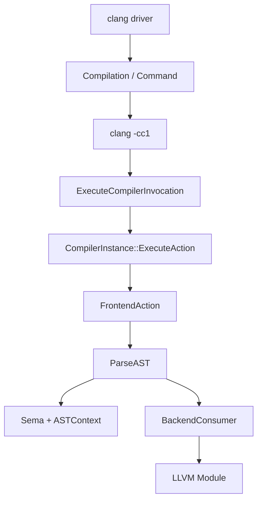

# Clang 前端：从源码到 LLVM IR

## 主调用链



本地源码锚点：

- `clang/tools/driver/driver.cpp`：driver 进程入口；
- `clang/tools/driver/cc1_main.cpp`：内部前端入口；
- `clang/lib/FrontendTool/ExecuteCompilerInvocation.cpp:209`；
- `clang/lib/Frontend/CompilerInstance.cpp`；
- `clang/lib/Parse/ParseAST.cpp`；
- `clang/lib/CodeGen/CodeGenAction.cpp`；
- `clang/lib/CodeGen/BackendUtil.cpp`。

## 三个容易混淆的对象

| 对象 | 仍然知道什么 | 谁主要使用 |
| --- | --- | --- |
| `Expr` / `Stmt` / `Decl` | C/C++ 语言语义 | Parser、Sema、Clang CodeGen |
| `QualType` | const、引用、record、函数原型 | ASTContext、Sema |
| `llvm::Value` / `llvm::Type` | 降低后的 IR 类型和值 | LLVM optimizer/backend |

## 用 AST dump 建立第一条联系

```bash
cat > add.c <<'EOF'
int add(int a, int b) { return a + b; }
EOF

clang -Xclang -ast-dump -fsyntax-only add.c
clang -O0 -S -emit-llvm add.c -o add.ll
```

从 `FunctionDecl add` 向下找到 `ReturnStmt` 与 `BinaryOperator '+'`，再对照 IR 中的 `add` 和 `ret`。第一遍只建立“哪个 AST 节点产生哪类 IR”，不要追所有 visitor。

## builtin 是在哪里分流的

普通 call 通常生成对函数 symbol 的调用；builtin 会在 `clang/lib/CodeGen/CGBuiltin.cpp` 的 `CodeGenFunction::EmitBuiltinExpr()` 中尝试：

1. 常量折叠或通用 builtin 处理；
2. builtin 名称到 LLVM intrinsic 的自动映射；
3. 目标专用 `Emit*BuiltinExpr()`；
4. 其他 fallback 或 unsupported 诊断。

完整公开例子见 [builtin 如何变成机器指令](../qa/builtin-to-instruction)。

