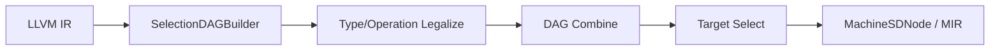

# 指令选择与 TableGen

## SelectionDAG 路线



LLVM IR intrinsic 通常被构造成 `INTRINSIC_W_CHAIN`、`INTRINSIC_WO_CHAIN` 或 `INTRINSIC_VOID` 节点。目标后端必须让这个节点最终变成一个或多个目标 opcode。

## 两条选择路径

以公开 RISC-V 后端为例，`RISCVDAGToDAGISel::Select(SDNode *Node)`：

1. 先处理已经是 machine opcode 的节点；
2. `switch` 中处理复杂、难以表述的目标特例；
3. 默认调用 TableGen 生成的 `SelectCode(Node)`。

```cpp
// llvm/lib/Target/RISCV/RISCVISelDAGToDAG.cpp
void RISCVDAGToDAGISel::Select(SDNode *Node) {
  // ... handwritten cases ...
  SelectCode(Node);
}
```

如果手写逻辑和生成匹配器都没有选择节点，`SelectionDAGISel::CannotYetSelect()` 才输出 `Cannot select:`。

## Pattern 表达什么

公开 AArch64 DMB 例子：

```tablegen
def DMB : CRmSystemI<barrier_op, 0b101, "dmb",
                     [(int_aarch64_dmb (i32 imm32_0_15:$CRm))]>;
```

它同时把目标指令记录和 DAG pattern 联系起来。匹配还会受 ValueType、operand predicate、subtarget predicate 和复杂 pattern 影响。

## `Cannot select` 的检查顺序

1. IR intrinsic 的名称和签名是否正确；
2. DAG 中节点 opcode、result VT、operand VT 是什么；
3. 类型/操作是否合法，是否应 custom lower；
4. pattern 是否被 include 并生成；
5. subtarget feature predicate 是否成立；
6. 手写 `Select()` 是否提前改写了节点。

::: warning
“存在同名指令定义”不等于“存在从当前 DAG 节点到该指令的匹配路径”。指令格式、pattern 和 lowering 是不同层次。
:::

