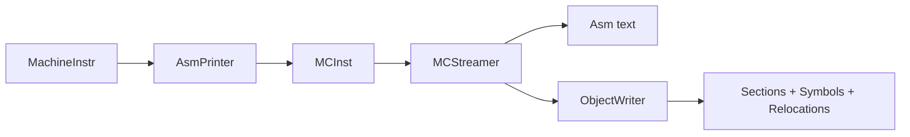

# MC、汇编与目标文件

## MachineInstr 不是最终字节



`AsmPrinter` 把带 MachineFunction 上下文的指令降低成更轻量的 `MCInst`。`MCCodeEmitter` 编码 opcode/operand；`MCAsmBackend` 处理 fixup；object writer 组织 ELF/COFF/Mach-O。

## 目标目录中的 MC 组件

以 RISC-V 为例：

```text
llvm/lib/Target/RISCV/MCTargetDesc/
llvm/lib/Target/RISCV/AsmParser/
llvm/lib/Target/RISCV/Disassembler/
```

## 一个 relocation 实验

```c
extern int external_value;
int read_external(void) { return external_value; }
```

```bash
clang -c reloc.c -o reloc.o
llvm-objdump -dr reloc.o
readelf -S -s -r reloc.o
nm -C reloc.o
```

你应能同时指出：

- `.text` 中哪条指令引用外部符号；
- relocation section 中记录了什么；
- symbol table 中该符号为什么是 `UND`；
- 链接器拿到最终地址后修补哪一处。

