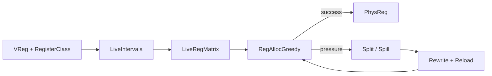

# 寄存器分配与 spill

## 分配器要同时满足什么

每个虚拟寄存器都有 register class、live interval 和机器指令 operand constraint。分配器需要选择一个合法物理寄存器，并避免活跃区间冲突；资源不足时通过 split、spill、reload 改写函数。



## 关键概念

- virtual register：数量不受硬件限制的 SSA-like 机器值；
- physical register：ISA 真正存在的寄存器；
- register class：允许的物理寄存器集合与类型/宽度约束；
- live interval：值从定义到各次使用的活跃范围；
- spill：把值暂存 stack slot；
- reload：从 stack slot 重新装回寄存器。

## 源码入口

```text
llvm/lib/CodeGen/RegAllocGreedy.cpp
llvm/lib/CodeGen/LiveIntervals.cpp
llvm/lib/CodeGen/LiveRegMatrix.cpp
llvm/lib/CodeGen/InlineSpiller.cpp
llvm/lib/CodeGen/VirtRegMap.cpp
llvm/lib/CodeGen/ExpandPostRAPseudos.cpp
```

## 调试方法

```bash
llc -verify-machineinstrs \
  -print-before=greedy -print-after=greedy \
  input.ll -o /dev/null 2> regalloc.log
```

如果最终在 Post-RA `copyPhysReg()` 崩溃，先比较：

1. COPY 在 pre-RA 是否已经跨宽度/跨类；
2. 虚拟寄存器分配前最终 class 是什么；
3. 哪个物理寄存器被分给它；
4. subregister 信息是否在某个 pass 丢失。

修复目标 hook 前要验证 class 的 spill size、copy、load/store 与 subreg 语义，不能只因为两个 class 在 TableGen 中有包含关系就扩大。

